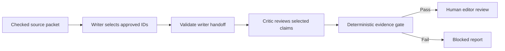

# Evidence Gate

**An AI draft should reach an editor with its evidence and failure states visible.**

This local prototype turns a checked source packet into an unpublished review artifact. A writer selects evidence, a separate critic reviews the handoff, and deterministic code decides whether the result can reach a human editor. Even a passing result has `publishable: false`.

**[Inspect a captured run](examples/report.json) · [Read the review artifact](examples/review.md) · [Portfolio and contact](https://tomas-garbarino.vercel.app/)**

## The problem it explores

A model can approve another model's unsupported wording. Asking a critic to be careful does not make approval a reliable publication rule.

Evidence Gate explores a narrower contract: select from a checked set of claim and question IDs, validate the handoffs in code, and keep final editorial judgment with a person. The included scenario is a grooming-content desk using a small sun-safety source packet. It is a demonstration of workflow design, not a clinical review or a publishing service.

## See it locally

Use **Node.js 22+ and npm**. There are no npm dependencies. Viewing the recorded example and running tests need no account, API key, or model download.

```sh
git clone https://github.com/tomigarbarino/editorial-evidence-gate.git
cd editorial-evidence-gate
npm test
npm run serve
```

Open **http://127.0.0.1:4178**. The desk loads the committed `examples/report.json`: a captured run, not a new inference request. The **“Test an invented citation”** action injects an unknown claim ID to demonstrate blocking even when the critic approves.

## Three different ways to inspect a run

| Mode | What it does | What it establishes |
| --- | --- | --- |
| **Review desk** (`npm run serve`) | Displays the committed example and lets you simulate an invalid citation. | How the recorded handoff and visible failure state are presented. |
| **Replay** (`npm run replay`) | Reuses the recorded writer/critic outputs and validates the packet against the current date. | Whether that saved chain still meets the current gate. It makes no model calls. |
| **Live** (`npm run live`) | Calls a locally running Ollama model twice, with distinct writer and critic prompts. | A new execution with captured outputs and trace metadata. |

**Freshness matters:** the bundled source packet was checked on **September 14, 2026**. Source checks older than 30 days are blocked, including in replay. A current replay can therefore exit with code `1` and `source check is stale or invalid`; this is the age gate working. The tests use explicit dates for repeatable cases. A new live run also requires a valid packet; recheck the source before updating its recorded check date.

The desk continues to load the committed example; it does not automatically switch to the latest `runs/` directory.

## How the workflow works



1. **Evidence packet:** a human-curated set of source notes, claims, and editor questions. Source URLs and check dates are validated before inference.
2. **Writer:** returns a title, angle, claim IDs, and approved question IDs. Unknown IDs stop the handoff.
3. **Critic:** must cover every selected claim with a reason, review the framing, and return a decision.
4. **Code gate:** checks coverage, duplicates, freshness, approved IDs, and review status. Claim text comes from the packet rather than free-form writer output.
5. **Human editor:** receives either a blocked report or a draft marked `needs_editor_review`. There is no CMS or email publishing capability.

The two agent stages use the **same local model** in separate calls. This separates responsibilities; it does not provide independent-model consensus.

## A real failure, preserved as a regression

The [first captured run](examples/initial-report.json) asked why reapplication frequency was “often overlooked.” The source packet did not establish that premise, but the critic approved it.

The fix changed the contract: editor questions now come from an approved ID catalog. Free-text or unknown questions fail validation. The [regression test](test/regression.test.mjs) loads that original output and checks that the validator rejects it. The corrected historical run is preserved separately.

This makes the engineering decision inspectable: the repository contains the failure, the validation rule, and the test, rather than only a successful screenshot.

## Run a new local inference

After rechecking the source packet, have Ollama running with `qwen3.5:4b` available locally:

```sh
npm run live
```

`OLLAMA_MODEL` selects another installed model; `OLLAMA_URL` can select another localhost endpoint. Remote model hosts are rejected before sending data. Each call has a 90-second deadline and an output-token budget; failures produce a blocked report without an automatic retry loop.

Each execution creates `runs/<timestamp>/` with a report and Markdown artifact. A chain that passes the initial evidence check also records the packet and stage outputs with hashes and timings. Local inference uses your hardware; no new live run is implied by viewing the saved example.

## Where to inspect the code

| File | Responsibility |
| --- | --- |
| [Evidence packet](data/evidence.json) | Manually checked source notes, claim IDs, and approved questions. |
| [Agent calls and schemas](src/agents.mjs) | Distinct prompts, output schemas, localhost restriction, deadlines, and truncation handling. |
| [Shared gate](src/core.mjs) | Handoff validation, final decision, and rendering boundaries. |
| [Runner](src/run.mjs) | Live/replay execution, reports, trace hashes, and exit status. |
| [Review desk](index.html) | Recorded example and interactive invalid-citation demonstration. |
| [Tests](test/gate.test.mjs) | Evidence fabrication, review coverage, freshness, output failures, escaping, and endpoint restrictions. |
| [Regression tests](test/regression.test.mjs) | The original failure and malformed handoffs. |

## Scope and evidence

The repository contains **14 automated tests** and captured writer/critic outputs from **September 14, 2026**. The historical corrected run reached editor review; that is not a claim that the saved packet still passes today's age check. The original browser verification covered desktop and mobile layouts; it is distinct from a fresh live model run.

Source notes paraphrase a small part of [NHS sun-safety guidance](https://www.nhs.uk/live-well/seasonal-health/sunscreen-and-sun-safety/). Checks are manual snapshots, not crawling or continuous verification. The age gate measures when a source was checked, not when the source changed. Region-specific guidance still requires editorial review.

The prototype's regex checks cover a small subset of harmful framing, both model stages can share errors, and title/angle review remains probabilistic. No customer data, private CVs, production credentials, or confidential hiring questions are needed for the public example.

## Applying the pattern

The transferable work is the handoff design: bounded evidence selection, explicit failure states, reproducible traces, and human review. Adapting it to a team's content or knowledge workflow requires defining that team's sources, review rules, and acceptance criteria; this repository does not establish production readiness or measured business results.

**[Explore my product work and get in touch](https://tomas-garbarino.vercel.app/)**
